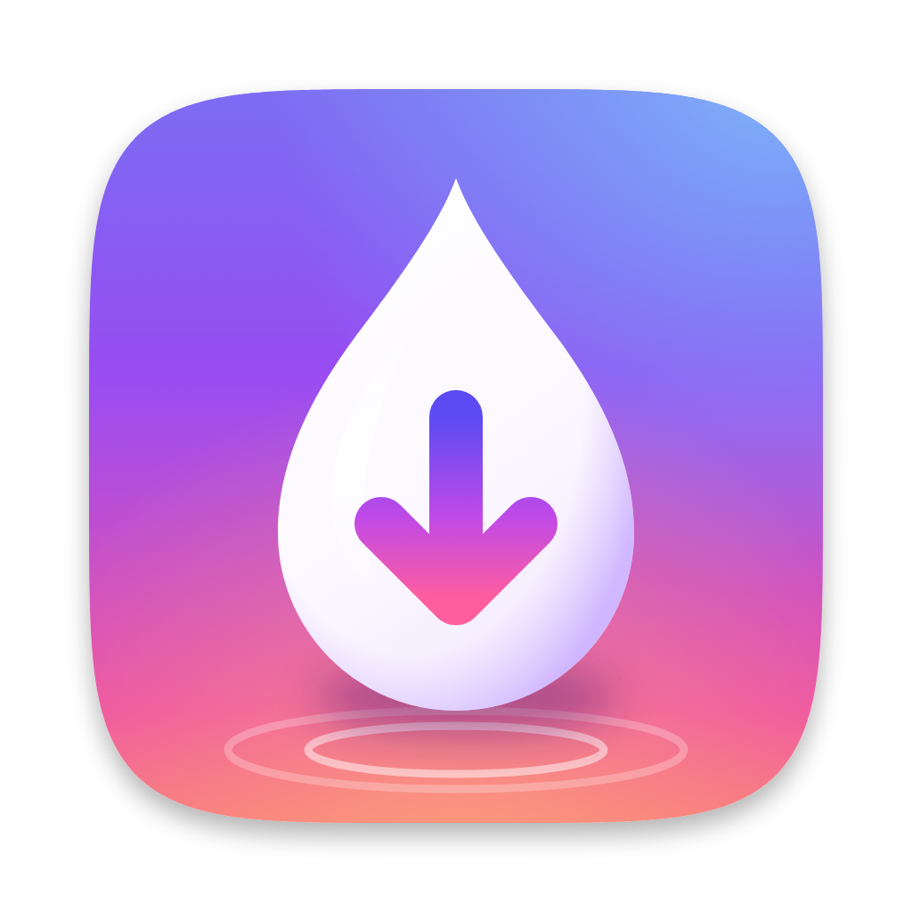
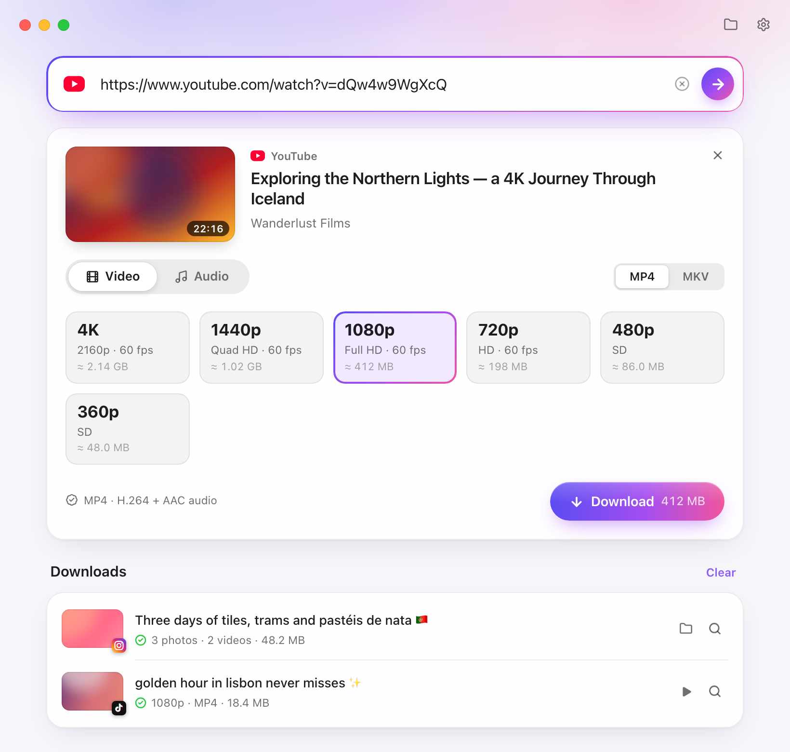
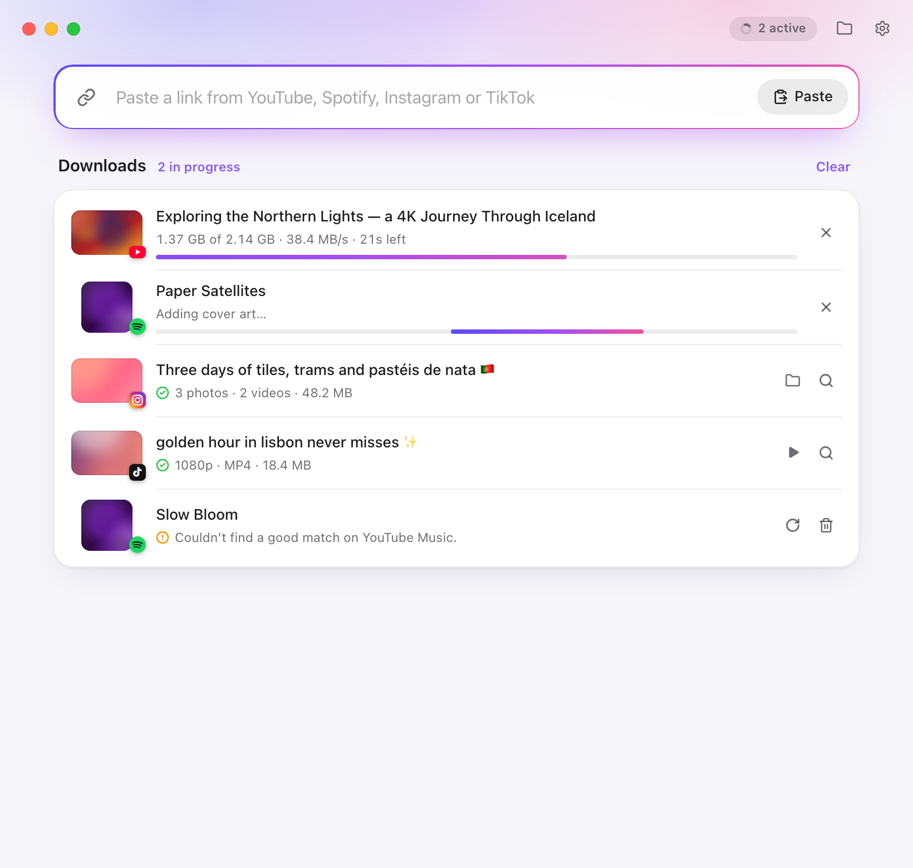
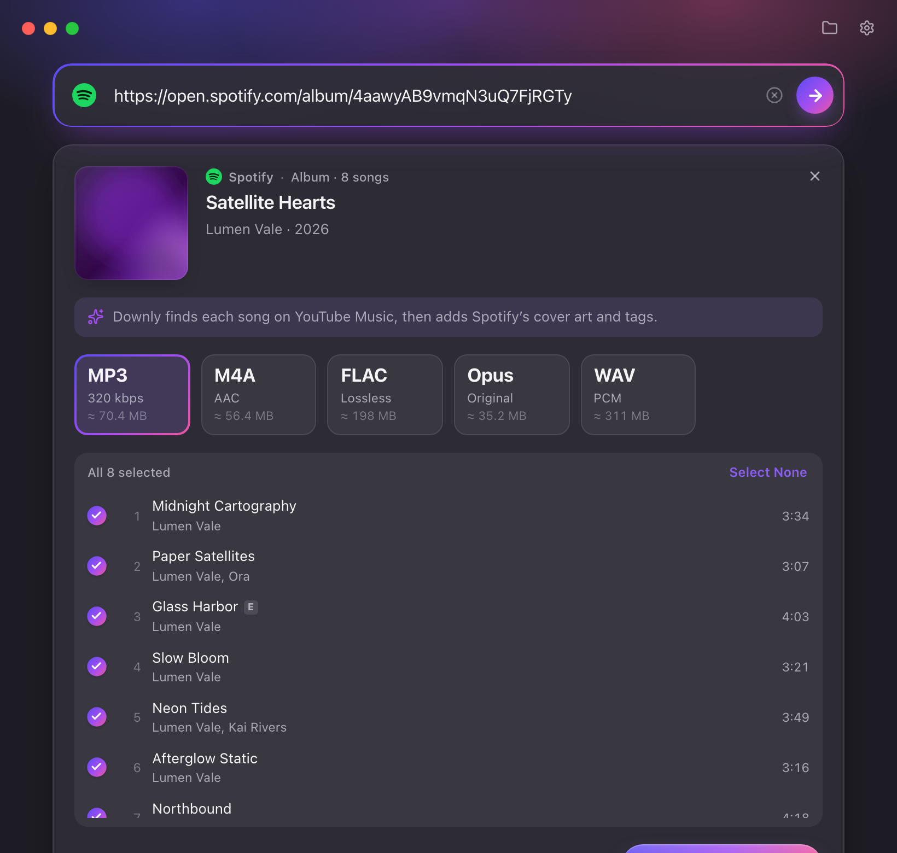
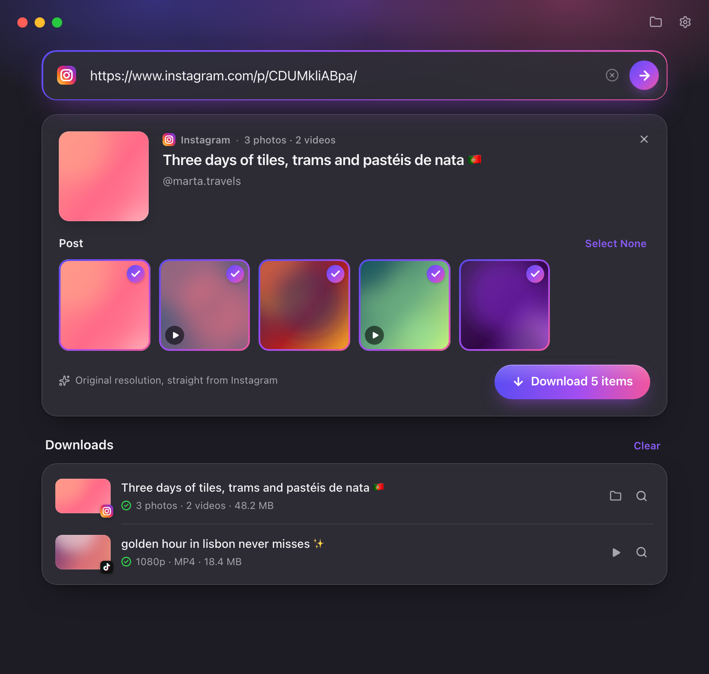
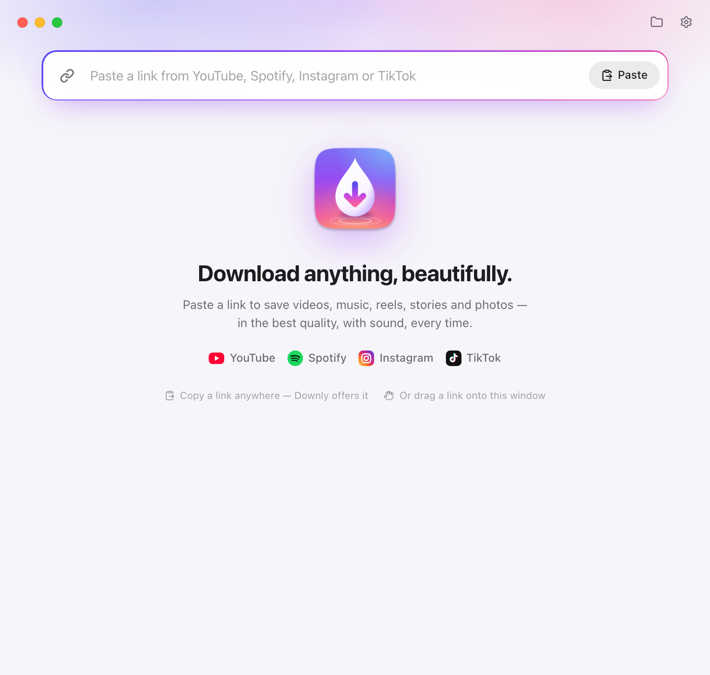

<p align="center">
  
</p>

<h1 align="center">Downly</h1>

<p align="center">
  <b>A Mac app for downloading from YouTube, Spotify, Instagram and TikTok.</b><br>
  Paste a link, pick a quality, done.
</p>

<p align="center">
  
</p>

## What it does

| | |
|---|---|
| **YouTube** | Every quality from 144p up to 8K, at 60 fps and in HDR when the video has it. Downloads always include sound. Playlists, Shorts, YouTube Music and audio-only downloads also work. |
| **Spotify** | Songs, albums and playlists. Downly works like the popular "Spotify downloaders": it reads the song info from Spotify, finds the same recording on YouTube Music, downloads it, then adds Spotify's cover art, title, artist and album. |
| **Instagram** | Posts, carousels with every photo and video, reels, stories, highlights and HD profile pictures. |
| **TikTok** | Videos without the watermark, photo posts and the sound on its own. |
| **Everything else** | Over 1,000 other sites work through [yt-dlp](https://github.com/yt-dlp/yt-dlp). |

Other details:
- **Plays on any Mac.** YouTube only offers 1440p, 4K and 8K as VP9 or AV1, which QuickTime can't always play. Downly can convert those to HEVC with your Mac's hardware encoder, so they open in QuickTime and Photos.
- **Audio as MP3 (320 kbps), M4A (original AAC), Opus, FLAC or WAV**, with cover art and tags.
- **Fast and neat.** Up to 6 downloads at once, parallel fragment downloads, and real progress, speed and time left. Partial files stay out of your Downloads folder.
- **Works the Mac way.** Copy a link anywhere and Downly offers it when you switch back. You can also drag a link onto the window. Translucent window, native menus and right-click menus, dark mode, a Dock badge while downloads run, and a notification when they finish in the background.
- **Keeps itself working.** Sites change often, so Downly checks for a new download engine once a day.

## Screenshots

<p align="center">
  
  
</p>
<p align="center">
  
  
</p>

## Install

1. Download **Downly.dmg** from the [Releases](../../releases) page. Every build is also attached to the [Build workflow](../../actions/workflows/build.yml) runs.
2. Open the DMG and drag **Downly** into **Applications**.
3. Downly isn't signed with a paid Apple Developer ID, so macOS blocks it the first time. Open **System Settings → Privacy & Security**, scroll down and click **Open Anyway**. You can also run this in Terminal:

   ```sh
   xattr -dr com.apple.quarantine /Applications/Downly.app
   ```

4. On first launch Downly downloads its components (yt-dlp, FFmpeg and Deno, about 150 MB). This happens once.

Requires **macOS 12 Monterey or later**. Runs natively on Apple Silicon and Intel.

## One-click download from your browser

Downly registers `downly://` links. Add this bookmarklet to your browser's favorites bar, then click it on any YouTube, Spotify, Instagram or TikTok page to open that page in Downly:

```js
javascript:location.href='downly://open?url='+encodeURIComponent(location.href)
```

## Signing in for stories and private posts

Instagram only shows stories, highlights and private posts to people who are signed in. Downly doesn't ask for your password. Instead it uses your existing sign-in from a browser on this Mac:

**Settings → Accounts → Use sign-in from → Chrome / Safari / Firefox / Brave / Edge / …**

- **Chrome-based browsers:** macOS asks once for access to the browser's keychain item. Click **Always Allow**.
- **Safari:** give Downly **Full Disk Access** in System Settings → Privacy & Security.

The same sign-in also helps when YouTube asks you to confirm you're not a bot, or when a video is age-restricted.

## Build from source

Downly is built with [Tauri](https://tauri.app): a Rust engine with a Svelte interface that runs in the Mac's own WebKit. You don't need the Xcode app. You need:

- [Node.js](https://nodejs.org) 20 or later
- [Rust](https://rustup.rs) (stable)
- the Xcode Command Line Tools: `xcode-select --install`

```sh
git clone https://github.com/julianrut/downly.git
cd downly
npm install
npm run tauri dev        # run the app with live reload
npm run tauri build      # builds src-tauri/target/release/bundle/macos/Downly.app
npm run tauri build -- --target universal-apple-darwin   # Apple Silicon + Intel
```

Every push also builds a universal DMG on GitHub Actions, so you can download a finished app from the [Build workflow](../../actions/workflows/build.yml) without building anything yourself.

Tests:

```sh
cargo test --lib --manifest-path src-tauri/Cargo.toml          # unit tests
cargo run --release --example selftest --manifest-path src-tauri/Cargo.toml -- --downloads   # checks every service against real links
```

To work on the interface in a normal browser, run `npm run dev` and open `http://localhost:1420/?demo=video`. Without Tauri, the UI uses sample data (`demo=home`, `video`, `spotify`, `gallery`, `profile`, `tiktok`, `playlist`, `downloads`, `setup`, `error`, or `window=settings&tab=formats`).

### Project layout

```
src/                      the interface (Svelte 5 + TypeScript)
src/settings/             the Settings window
src-tauri/src/engine/     the engine: link parsing, yt-dlp, Spotify, YouTube Music matching,
                          Instagram, TikTok, FFmpeg tagging and conversion, component installer
src-tauri/src/            the app shell: commands, download queue, menus, thumbnails
src-tauri/examples/        end-to-end self-test run in CI against real sites
design/                   icon source (SVG) and renders
```

## How the Spotify part works

Spotify doesn't let anyone download its audio, so Downly (like spotDL and similar tools) never touches Spotify's audio streams:

1. It reads the song details (title, artists, length and cover art) from Spotify's public embed page. No account or API key is needed.
2. It searches YouTube Music for the same song and scores each result on title, artist and length. Live versions, covers, remixes and sped-up edits get a penalty.
3. It downloads the best match's audio in the format you picked.
4. It writes Spotify's cover art and tags into the file. Albums and playlists are saved in their own folder.

## Responsible use

Download only content you own or have permission to save, and respect each platform's terms and creators' rights. Downly is a personal tool and isn't affiliated with YouTube, Spotify, Instagram or TikTok.
